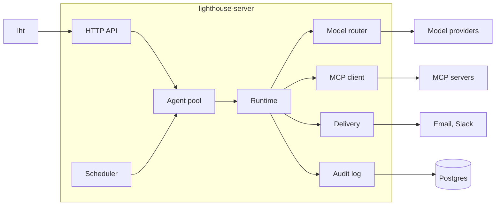

# Architecture

Lighthouse has one binary, `lighthouse-server`, and one command line, `lht`. Both use Postgres.

## Crates

| Crate | Purpose |
|---|---|
| `lighthouse-core` | Shared types and agent file parsing, without IO |
| `lighthouse-config` | `lighthouse.toml` and environment overrides |
| `lighthouse-store` | Postgres connection and migrations |
| `lighthouse-vault` | Encrypted credentials |
| `lighthouse-audit` | Append-only log of runs and steps, approvals and paused runs |
| `lighthouse-auth` | Sign-in of the owner and device tokens |
| `lighthouse-desk` | The owner's tasks, rules, memory, alerts and briefing documents |
| `lighthouse-sessions` | Desktop agents, Claude Code sessions and permission requests |
| `lighthouse-node` | Desktop agent, see [desktop-agent.md](desktop-agent.md) |
| `lighthouse-brain` | Second Brain: Markdown files, hybrid search, ingestion and `brain.*` tools, see [brain.md](brain.md) |
| `lighthouse-router` | Provider adapters, routing, fallback, costs |
| `lighthouse-mcp` | MCP client, OAuth flow, tool classification |
| `lighthouse-skills` | `SKILL.md` loading |
| `lighthouse-notify` | Email and Slack delivery, live events for the apps |
| `lighthouse-runtime` | The agent loop and the steps of automations |
| `lighthouse-scheduler` | Cron triggers and catch-up for agents and automations |
| `lighthouse-api` | HTTP API and OpenAPI description |
| `lighthouse-server` | Wiring and the server binary |
| `lighthouse-cli` | The `lht` binary |

## A run

1. Cron or an API call registers a run in the audit log.
1. The runtime reads the owner's rules for this agent. If they cannot be read, the run fails rather than run without them.
2. The runtime checks every tool of the agent. If one is declared below its real level, the run ends as `rejected`.
3. The runtime connects to the MCP servers and offers the granted tools to the model.
4. Model and tools take turns until the model answers without a tool call, or until a limit stops the run.
5. The report goes to the delivery targets. Tokens, costs and every step stay in the log.

## Safety

- **Tool levels:** only tools in a connector's `read_tools` or `draft_tools` escape `write`, whatever the agent file
  says. The runtime checks this before the start and again on every call.
- **Approvals:** a `write` call never runs by itself. The run saves its state and pauses. After the decision it continues
  with the tool result or a denial. The first decision wins, and a maintenance task expires old proposals and recovers
  runs after a restart.
- **Prompt injection:** tool results are wrapped in `<untrusted_content>` tags that their content cannot close, and the
  system prompt tells the model to treat them as data.
- **Owner rules:** enabled rules of the owner reach the system prompt in an `<owner_rules>` block, apart from tool
  results. Tool content cannot open or close that tag, so it cannot pose as a rule.
- **Secrets:** keys live in the vault and reach tools on the server side only. They never enter prompts or the log.
- **Audit log:** a database trigger rejects changes to recorded steps.
- **Limits:** every run has limits for steps, cost and time.

Tenant IDs exist in every table, so multi-tenancy can follow without a schema rewrite. The server currently runs in
single-tenant mode.
