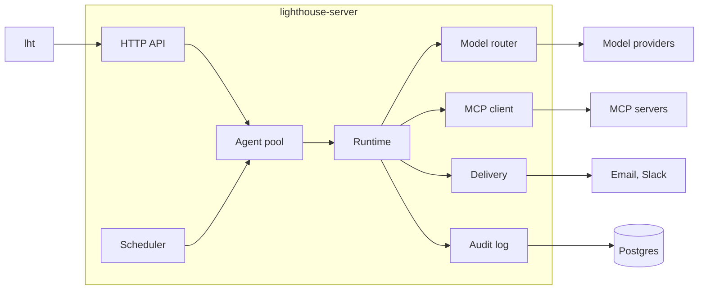

# Architecture

Lighthouse has one binary, `lighthouse-server`, and one command line, `lht`. Both use Postgres.

## Crates

| Crate | Purpose |
|---|---|
| `lighthouse-core` | Shared types and agent file parsing, without IO |
| `lighthouse-config` | `lighthouse.toml` and environment overrides |
| `lighthouse-store` | Postgres connection and migrations |
| `lighthouse-vault` | Encrypted credentials, shared per tenant and personal per member |
| `lighthouse-settings` | Providers, models, routing and connectors in layers: instance, tenant, personal |
| `lighthouse-audit` | Append-only log of runs and steps, approvals and paused runs |
| `lighthouse-auth` | Users, tenants, memberships, invitations and device tokens |
| `lighthouse-desk` | The owner's tasks, rules, memory, alerts and briefing documents |
| `lighthouse-sessions` | Desktop agents, Claude Code sessions and permission requests |
| `lighthouse-node` | Desktop agent, see [desktop-agent.md](desktop-agent.md) |
| `lighthouse-brain` | Second Brain: Markdown files, hybrid search, ingestion and `brain.*` tools, see [brain.md](brain.md) |
| `lighthouse-router` | Provider adapters, routing, fallback, costs |
| `lighthouse-mcp` | MCP client, OAuth flow, tool classification |
| `lighthouse-sync` | Cache of mail, calendar, issues and pull requests from connectors, see [connected.md](connected.md) |
| `lighthouse-skills` | `SKILL.md` loading |
| `lighthouse-notify` | Email and Slack delivery, live events for the apps |
| `lighthouse-runtime` | The agent loop and the steps of automations |
| `lighthouse-scheduler` | Cron triggers and catch-up for agents and automations |
| `lighthouse-api` | HTTP API and OpenAPI description |
| `lighthouse-server` | Wiring and the server binary |
| `lighthouse-cli` | The `lht` binary |

## A run

1. Cron or an API call registers a run in the audit log.
1. The runtime reads the owner's rules for this agent. If they cannot be read, the run fails rather than run without them.
2. The runtime checks every tool of the agent. If one is declared below its real level, the run ends as `rejected`.
3. The runtime connects to the MCP servers and offers the granted tools to the model.
4. Model and tools take turns until the model answers without a tool call, or until a limit stops the run.
5. The report goes to the delivery targets. Tokens, costs and every step stay in the log.

## Safety

- **Tool levels:** only tools in a connector's `read_tools` or `draft_tools` escape `write`, whatever the agent file
  says. The runtime checks this before the start and again on every call.
- **Approvals:** a `write` call never runs by itself. The run saves its state and pauses. After the decision it continues
  with the tool result or a denial. The first decision wins, and a maintenance task expires old proposals and recovers
  runs after a restart.
- **Prompt injection:** tool results are wrapped in `<untrusted_content>` tags that their content cannot close, and the
  system prompt tells the model to treat them as data.
- **Owner rules:** enabled rules of the owner reach the system prompt in an `<owner_rules>` block, apart from tool
  results. Tool content cannot open or close that tag, so it cannot pose as a rule.
- **Secrets:** keys live in the vault and reach tools on the server side only. They never enter prompts or the log.
- **Audit log:** a database trigger rejects changes to recorded steps.
- **Limits:** every run has limits for steps, cost and time.

## Tenancy

A **tenant** is the space a team, a company or a person works in. Every table carries a `tenant_id`. **Users** sign in
with an email address and belong to tenants through **memberships** with a role (`owner`, `admin`, `member`). A device
token belongs to one user and is bound to one tenant, so every request resolves to exactly one user and one tenant.

The server opens each tenant on first use as a **workspace**: its own vault, Brain, agent registry, scheduler, sync,
automations and live events, built from the shared configuration. Request paths never name a tenant themselves; they
use the workspace of the caller's token. Background work (the scheduler, maintenance, refreshes of connected sources,
automations, alerts and notifications) runs per workspace in its own tasks, so one failing tenant does not stop the
others. At start, and once a minute after, the server opens every tenant, so background work covers new tenants too.

The **default tenant** (the nil UUID) is the one a single-user install has always used. The configured `[owner]`
becomes its first owner, the admin token acts in it, and it cannot be deleted. Deleting another tenant removes every
row with its `tenant_id` in one transaction, its files and its background work.

### Personal and shared data

Within a tenant, most data is shared by its members. Some is personal: it belongs to one user and other members never
see it, whatever their role. The admin token, agents and background work see everything of the tenant.

| Data | Visibility | How |
|---|---|---|
| Device tokens | Personal | `device_tokens.user_id` |
| Desktop agents (nodes), their Claude Code sessions, events, messages, usage and permission requests | Personal | `nodes.user_id`, set from the token that reports |
| Conversations (Talk) | Personal | `talk_threads.user_id` |
| Mail and calendar (connected items of the `mail` and `calendar` domains), and every item of a personal source | Personal | `synced_items.user_id` |
| Runs, their steps and approvals (decisions in Ready), drafts, briefs and recaps | Personal to the user a run works for | `runs.user_id` |
| Brain, tasks, rules, memory (facts), alerts, automations, agents, organizations, issues, pull requests, deals, invoices, bank accounts, posts, decks, contracts, branding, settings and budget | Shared in the tenant | `tenant_id` only |
| Model provider keys and connector tokens of the tenant (the vault) | Shared in the tenant; only owners and admins change them | `credentials.tenant_id` without `user_id` |
| A member's own provider keys and connector tokens | Personal | `credentials.user_id` |
| Providers, models, routing and connectors set for the tenant | Shared in the tenant; only owners and admins change them | `settings_*` rows without `user_id` |
| A member's own providers, models, routing and connectors | Personal | `settings_*.user_id` |

A run works for the user who started it, through the API, Talk or a delegated task. Runs from schedules and
automations work for the tenant's first owner, the person whose accounts the agents use (`tenant_primary_user`). What
such a run reads from mail and calendar therefore stays in that person's Ready feed, briefs and recaps. Proposals a run
makes into shared areas, such as tasks, facts or posts, are shared once they exist.

Removing a member deletes their conversations, desktop agents and mail and calendar items in that tenant and signs
out their devices there; their runs stay in the audit log. Deleting an account deletes all of this in every tenant.
Live events go to the members of the tenant they happened in and carry IDs only, never content.

A run resolves providers, keys and connectors for the user it works for: their own entries over the tenant's over the
instance's (see [configuration.md](configuration.md#layers)). A member who connects a connector for themselves gives
only their own runs that account. Shared connected sources sync with the tenant's connector tokens, and their mail and
calendar items belong to the tenant's first owner. A member's own sources sync with their connectors and tokens, and
all their items reach only that member, see [connected.md](connected.md#sources-in-layers).

### Settings in layers

`lighthouse-settings` keeps the tenant and personal layers of a tenant in memory as one snapshot. Every change runs
through it: it checks the input against the latest state, writes the row, records who changed what, raises the
tenant's revision and swaps in a new snapshot. A run takes its router and its MCP connections when it starts or
resumes, so a new provider, key or URL applies to the next start. The tool policy answers from the current snapshot on
every call, so a change to `read_tools` or `draft_tools` also applies to a run under way. All three resolve for the
acting user, which `Runtime::as_run_user` sets from the run's `user_id`. Each workspace compares its revision with the database every 15 seconds, so several server processes
see each other's changes.

Outbound requests to endpoints that tenants or people chose go through a guarded HTTP client
(`lighthouse_router::net`): `https` only, names resolved through a resolver that drops every address that is not
public, and redirects followed only to public `https` URLs. A check when the setting is saved gives an early error;
the client's check at connection time also stops DNS rebinding.

Cost accounting is per tenant (`runs.tenant_id`, `run_steps.tenant_id` and the monthly budget) and per user through
`runs.user_id` and the nodes behind Claude Code usage.

### Isolation

Each repository (`Desk`, `AuditLog`, `Sessions`, `SyncStore`, `Vault`, `Brain`, the scheduler) is created for one
tenant and binds its `tenant_id` into every statement. Two checks keep it that way:

- **A guard over the code:** `crates/store/tests/tenant_guard.rs` reads every SQL statement in the library code and
  fails when one reads or writes a table with a `tenant_id` column without naming `tenant_id`. The tables come from
  the migrations, so new tables are covered without changes. The few exceptions are listed in the test with their
  reason, such as device tokens, which are instance-wide and found by their hash.
- **Cross-tenant tests:** `crates/server/tests/isolation.rs` creates rows in one tenant and tries to read, change and
  delete them by ID through the repositories of another. Every attempt must find nothing.

Postgres row-level security with `SET LOCAL app.tenant_id` per transaction was considered and not chosen for now:
the repositories run single statements on the shared pool rather than transactions, so every query would have to be
wrapped, and background work that legitimately spans tenants (opening workspaces, deleting a tenant, the accounts
layer) would need a second, privileged role. The guard and the tests give the same protection against the likely
mistake, a statement that forgets its tenant, without that rewrite. Row-level security stays a later step for
defence in depth.

## Extension points

`lighthouse-server` is a library with a thin binary. Another program can build its own server on the public crates
with `lighthouse_server::build_with(config, hooks)` and serve the returned router the same way. `Hooks` holds:

| Field | Trait or type | Default | Consulted |
|---|---|---|---|
| `lifecycle` | `lighthouse_api::hooks::Lifecycle` | `NoHooks` | `on_start` once in `build_with`, before the server serves, with the `Instance`. `on_signup` before an account is created; it may allow, reject (403) or hold the sign-up (202, nothing created). `on_tenant_created` after sign-up, `POST /tenants` and `Instance::create_tenant` with an owner, `on_tenant_deleted` after a tenant is deleted. `on_invitation_accepted` with the user, tenant and role after an invitation was accepted, by a new or an existing user. `on_member_removed` after a member was removed or left through `DELETE /tenant/members/{user}` |
| `entitlements` | `lighthouse_api::hooks::Entitlements` | `AllowAll` | With an `Action`: `CreateTenant` before a user creates another tenant; `InviteMember` with the current `members`, the open invitations (`pending`) and the `role` before an invitation; `RunAgent` before every agent run, by hand, from a task, from Talk, on a schedule or as a step of an automation; `Ask` before a question to the Brain through `/brain/ask` or a conversation without a Talk agent; `ChangeSettings` with the `user`, whether it is their `personal` layer and the `area` (`provider`, `model`, `route` or `connector`) before a settings change. A refusal answers 403, or 409 for runs and questions; scheduled runs are skipped and logged, refused automation steps fail the automation run with the message. `Action` is `#[non_exhaustive]`, so match it with a catch-all arm |
| `mailer` | `lighthouse_notify::Mailer` | `SmtpMailer` from `[delivery.smtp]`, or none | Every mail of the server goes through it: email verification, invitations and reports delivered to `mail:` targets. A `Mail` has a recipient, a subject, a plain text body and an optional HTML body |
| `mail_templates` | `lighthouse_api::hooks::MailTemplates` | `EnglishMails` | Writes the subject and bodies of the verification and invitation mails. Every method has an English default, so an implementation overrides only the mails it changes, for example to translate them |
| `routes` | `lighthouse_api::Extensions` | none | `public` routes are merged as they are; `signed_in` routes sit behind the sign-in and can extract `Caller` (user, tenant, role) and `Scoped` (the tenant's state), with `Instance` (accounts and the store) as router state |

The defaults allow everything, which is how `lighthouse-server` runs.

### The instance handle

`lighthouse_api::Instance` holds the accounts, the tenants and the mailer of the instance. Programs get it in
`Lifecycle::on_start`, as router state of their extra routes, and as `App::instance`. It is cheap to clone, so a
program keeps a clone for background work. Its calls skip the role checks and entitlements of the HTTP API, since the
program decides who may do what:

| Call | What it does |
|---|---|
| `create_tenant(name, owner: Option<Uuid>) -> TenantId` | Creates a tenant. Without an owner it has no members until someone accepts an invitation, for example as its owner; `on_tenant_created` runs only with an owner |
| `invite(tenant, email, role, invited_by) -> SentInvitation` | Invites someone as owner, admin or member and mails the invitation if a mailer is set. The answer holds the invitation, the accept link and whether it was mailed. Accepting needs `tenancy.signup` to be `invite` or `open` |
| `list_tenants() -> Vec<Tenant>` | Every tenant of the instance, oldest first |
| `delete_tenant(tenant)` | Deletes a tenant like `DELETE /tenant`: its data, its open workspace and its files, then `on_tenant_deleted` |
| `forget_tenant(tenant)` | Stops the background work of a tenant and removes its files, leaving its data; it opens again on next use |
| `send_mail(to, MailText) -> bool` | Sends a mail through the mailer; `false` without one or on failure |

`Instance::extension_config` holds the `[extensions]` tables of the configuration (see
[configuration.md](configuration.md#extensions)); `accounts` gives the lower-level calls of `lighthouse_auth::Accounts`.
